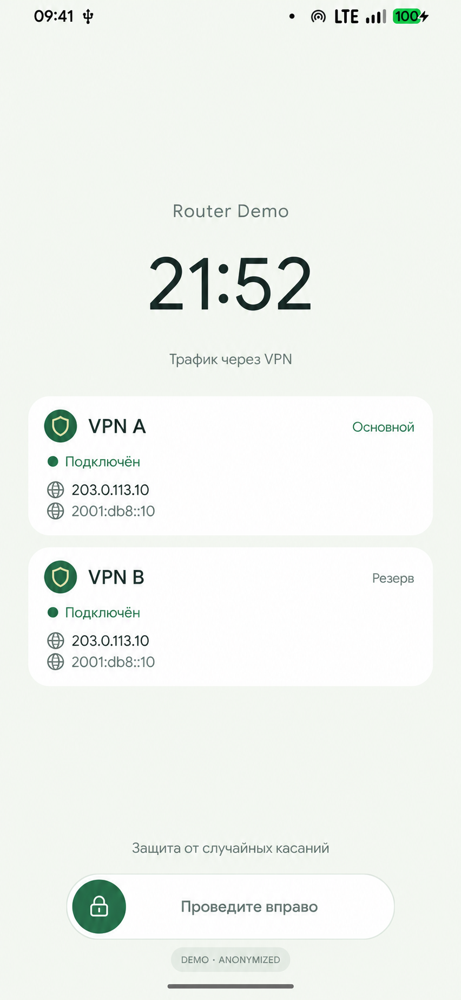
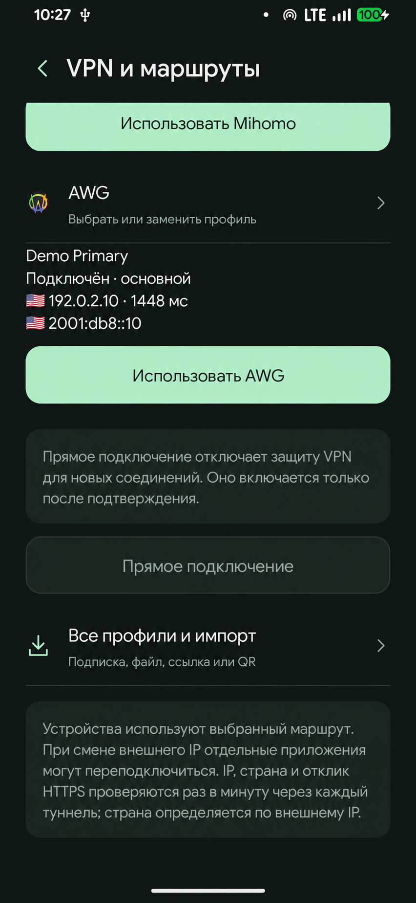
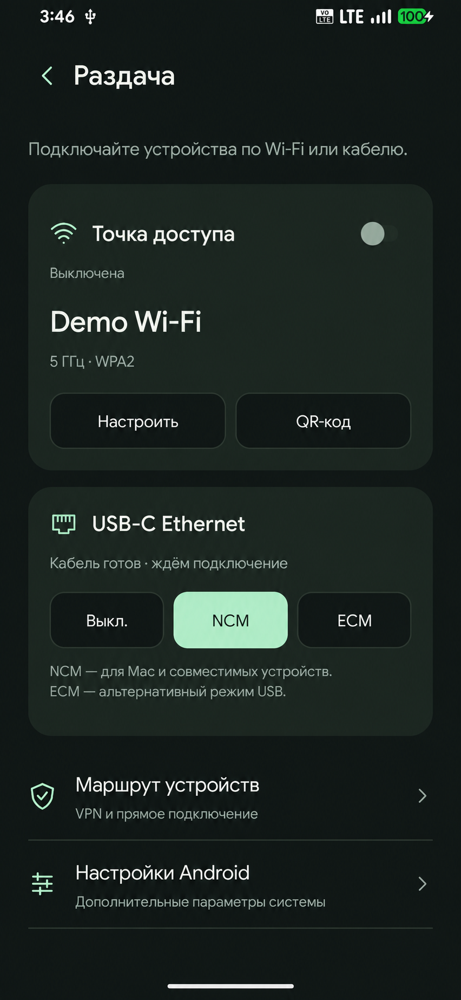
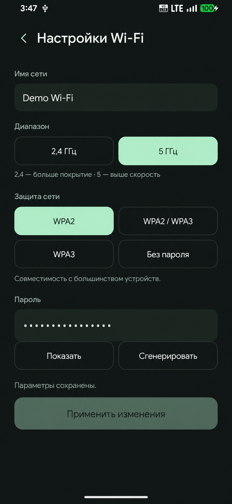
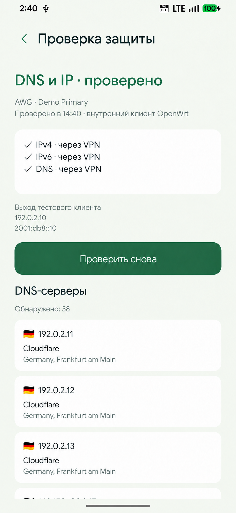
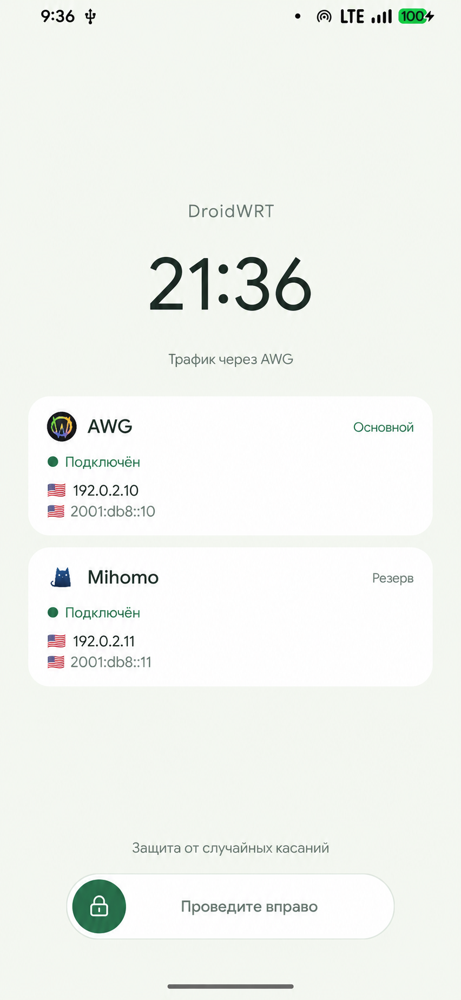

<p align="center"><a href="README.md">English</a> · <a href="README.ru.md">Русский</a></p>
<h1 align="center">DroidWRT</h1>
<p align="center">A rooted Android phone turned into a portable OpenWrt router.</p>
<p align="center">   </p>

<p align="center"></p>
> Anonymized presentation image: branding and data were replaced with AI. An interface illustration, not an unedited screenshot.

## Interface gallery

Individual views of the current interface. Addresses, profile names and network identity were replaced with demo values using AI.

### VPN and routes

<p></p>

### Connection sharing

<p></p>

### Wi-Fi settings

<p></p>

### Protection checks

<p></p>

### Pocket lock

<p></p>

## Highlights

| Feature | What is included |
| --- | --- |
| One control panel | A native Android panel for router status, networks and VPN profiles. |
| Multiple uplinks | Integration for mobile data, Wi-Fi and USB/Ethernet sharing. |
| VPN routing | AmneziaWG and Mihomo integration, health checks, recovery and kill-switch logic. |
| Device integration | Go control service, Android helper, kernel patches and SystemUI customization. |

## Source layout

| Path | Contents |
| --- | --- |
| `panel/` | Java Android control panel. |
| `openwrt/` | Go service, integration scripts and module. |
| `android/ · system-ui/` | Android integration and UI customization. |
| `kernel/` | Device-specific kernel build scripts and patches. |

## Local development

```sh
cd openwrt
go test ./...
mkdir -p ../out
CGO_ENABLED=0 GOOS=linux GOARCH=arm64 go build -o ../out/droidwrt-control .
```

For the Android panel: provide a JDK through `JAVA_HOME`, Android SDK through `ANDROID_HOME`, and Android API 36 / Build Tools 36. Then run `python3 panel/build.py`. Building does not flash the device.

## Project status & scope

The working target is Redmi Note 8 Pro (begonia), with root and a compatible Android/kernel/OpenWrt environment. This source snapshot is not universal firmware or a one-click installer. VPN credentials, firmware images, boot dumps and private diagnostic captures are excluded. Build scripts may require external sources and device-specific prerequisites.

## License

Original standalone code is provided under [PolyForm Noncommercial 1.0.0](LICENSE); this license does not grant commercial use. It does not replace third-party licenses or the licenses of kernel-derived patches. See [LICENSE-SCOPE.md](LICENSE-SCOPE.md).

---

<p align="center">
<a href="https://t.me/tribute/app?startapp=dK9j"></a>
<a href="https://nowpayments.io/donation/svllvsx"></a>
<a href="https://t.me/svllvsxprod"></a>
</p>
